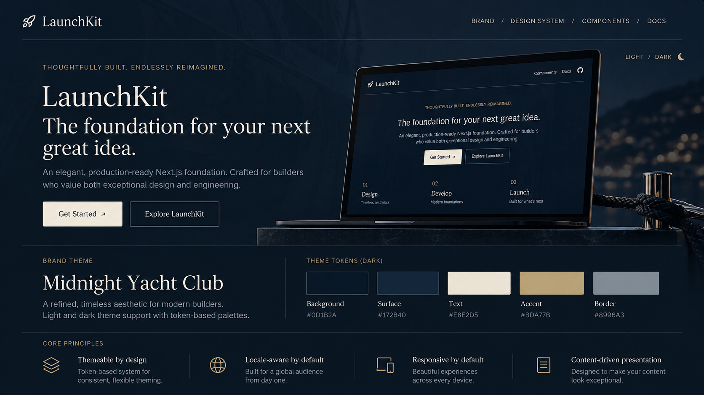
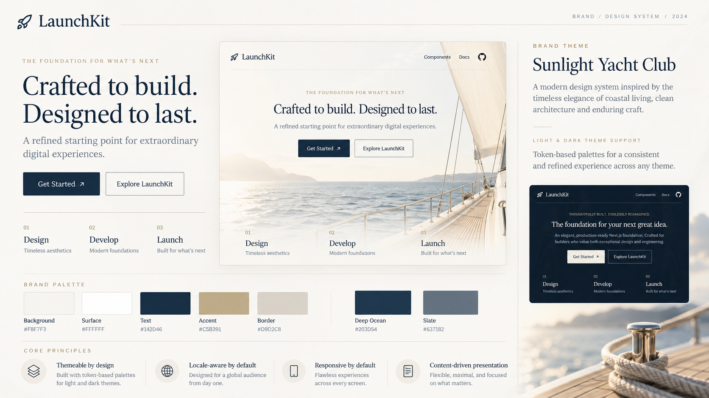

 

  
  <h2>A reusable foundation for building & launching ideas.</h2>
  

    
  

  

    <a href="https://launch-kit-flax.vercel.app/" target="_blank" rel="noopener noreferrer">
      Live Demo ↗
    </a>
  

<!-- -------------------------------------------------------------------------- -->

### About This Project

---

**LaunchKit is a reusable foundation for building and launching better websites, faster and cheaper.**   It provides everything a modern website needs — responsive UI, themes, localization, section-based content, forms, testing, CI and AI-assisted development — so each new project can launch faster and focus on what makes it different.

LaunchKit is maintained centrally, allowing improvements, dependency updates and security fixes to be shared across all downstream projects.

 
 
<!-- -------------------------------------------------------------------------- -->

### Philosophy

---

**Build once. Reuse often. Improve centrally.**   LaunchKit is intentionally opinionated about its foundations and flexible about everything built on top. Shared components and tooling belong upstream; branding, copy, custom sections, and business logic belong to the individual project. It's designed to be forked, adapted, and improved — not to force every website into the same template. The goal isn't to build the biggest starter kit. It's to build one that's genuinely useful, easy to maintain, and ready to grow with real projects.

 

<!-- -------------------------------------------------------------------------- -->

  

  

    Midnight Yacht Club & Sunlight Yacht Club design system.
  

<!-- -------------------------------------------------------------------------- -->

  
<strong>Tech Stack</strong>

| Area                     | Tooling                                              |
| ------------------------ | ---------------------------------------------------- |
| Framework                | Next.js 16 (App Router), React 19, TypeScript 6      |
| Styling & UI             | Tailwind CSS 4, shadcn/ui, semantic design tokens    |
| Localization             | next-intl, i18n-check                                |
| Content                  | TypeScript page definitions, Markdown, JSON messages |
| Forms & validation       | React Hook Form, Zod                                 |
| Environment              | T3 Env                                               |
| Code quality             | ESLint, Prettier, Lefthook, Commitlint               |
| Unit & integration tests | Vitest, Vitest Browser Mode                          |
| End-to-end tests         | Playwright, axe accessibility checks                 |
| Component development    | Storybook                                            |
| Automation               | GitHub Actions, Dependabot                           |
| Hosting                  | Vercel                                               |

---

<!-- -------------------------------------------------------------------------- -->

  
<strong>Features</strong>

- **Modern application foundation** — Next.js App Router, React, strict TypeScript, and Tailwind CSS.
- **Themeable design system** — shadcn/ui components, semantic tokens, light/dark/system appearance, and the _Midnight Yacht Club_ / _Sunlight Yacht Club_ reference brand.
- **Localization** — English, Spanish, French, and German; locale-aware routes, page content, navigation, metadata, and translation checks.
- **Section-based content** — typed, ordered page sections in `src/content/`, separate from React presentation components; Markdown for long-form content.
- **Reusable layouts and sections** — accessible navigation, responsive layouts, and essential marketing sections without a full visual page builder.
- **Validated forms** — React Hook Form and Zod, with client-side validation and server-side validation where forms are submitted.
- **Quality tooling** — strict type-checking, ESLint, Prettier, Lefthook, Commitlint, and type-safe environment configuration.
- **Testing and accessibility** — Vitest suites, browser integration tests, Storybook stories, desktop/mobile Playwright tests, and automated accessibility checks.
- **SEO and performance foundations** — metadata, Open Graph, canonical and alternate-language URLs, sitemap, robots, optimized assets, and modern rendering defaults.
- **GitHub workflow** — `staging` and `main`, pull-request CI, grouped Dependabot updates, and a controlled version-tag / GitHub Release process.

> LaunchKit is intentionally not bundled with a database, authentication provider, checkout system, or paid monitoring service. Those are added to downstream projects when there's a real requirement.

---

<!-- -------------------------------------------------------------------------- -->

  
<strong>Documentation</strong>

- [Project specification](docs/SPEC.md) — vision, scope, architecture, and development phases.
- [Style guide](docs/STYLE_GUIDE.md) — brand identity, light/dark palettes, typography, and visual direction.
- [Theming](docs/theming.md) — semantic tokens, brand customization, and shadcn/ui components.
- [Upstream sync](docs/upstream-sync.md) — creating downstream projects and merging LaunchKit improvements.
- [Releasing](docs/releasing.md) — branches, tags, GitHub Releases, and dependency updates.
- [Toolchain](docs/toolchain.md) — version decisions, compatibility, and maintenance notes.
- [Contributing](CONTRIBUTING.md) · [Security](SECURITY.md) · [Code of Conduct](CODE_OF_CONDUCT.md) · [Changelog](CHANGELOG.md)
- [Agent instructions](AGENTS.md) — coding conventions and explicit Git restrictions for AI agents.

---
